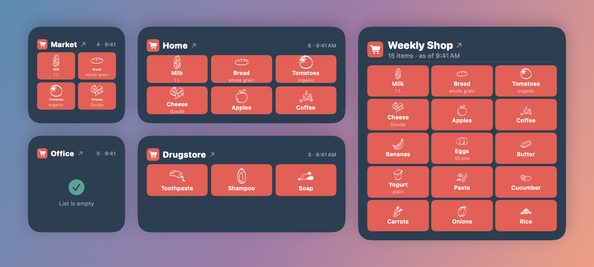
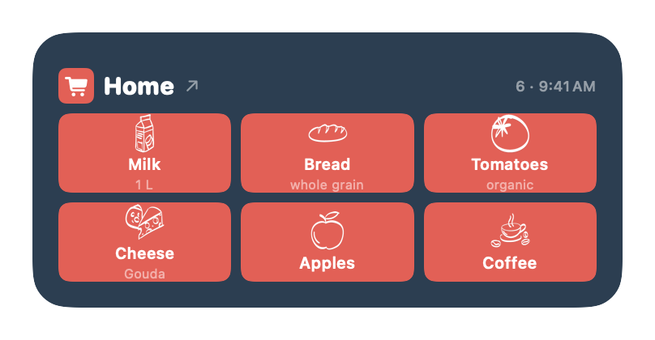
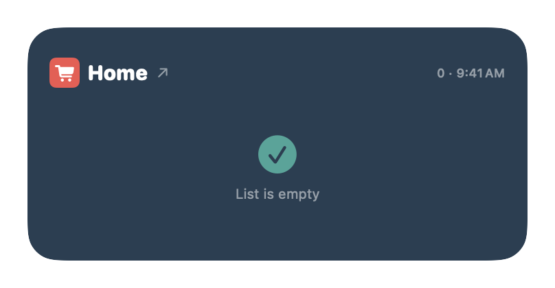
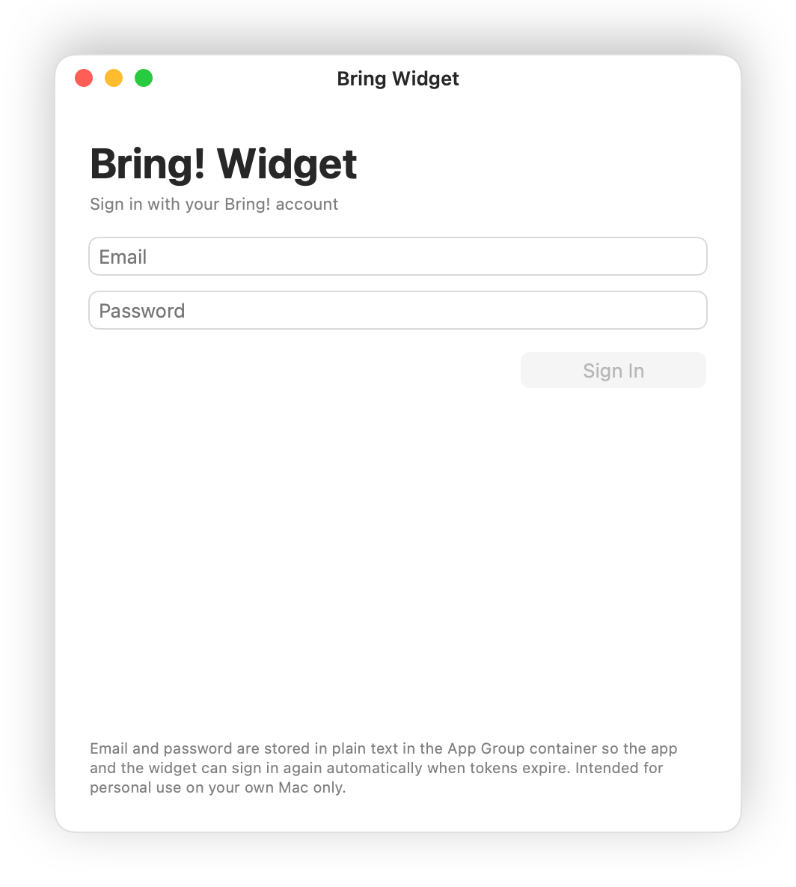
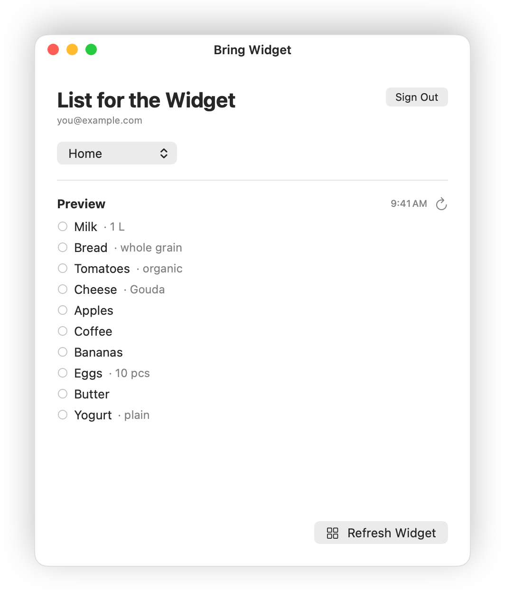

# Bring Widget for macOS

A native desktop widget for macOS Sonoma (14) and later that shows your
[Bring! shopping list](https://web.getbring.com) on your desktop — just
like the Weather or Photos widget.



> **Unofficial.** This project is not affiliated with Bring! or its
> operator. The app uses the same HTTP endpoints as the official Bring!
> web app and keeps your login data on your Mac only.

**➜ Step-by-step guide with screenshots: [docs/GUIDE.md](docs/GUIDE.md)**

## Features

| Medium | Empty list |
| --- | --- |
|  |  |

- **Widget in three sizes** (small, medium, large) showing your selected
  Bring! list — list header and item tiles in Bring! style, with the
  Bring! item icons (where available) or the item's first letter.
- **Click the items** → reloads the list immediately, straight from
  api.getbring.com.
- **Click the list name** (↗) → opens the list on `web.getbring.com` in
  your browser, where you add and check off items or share lists.
- **Auto-refresh** about every 20 minutes (macOS caps widget updates at
  roughly 40–70 per day anyway).
- **Background app without a Dock icon** for sign-in and list selection;
  add it as a login item so the widget is up to date right after a
  restart.
- **Item names in your list's language** — catalog items are translated
  with Bring!'s public article tables into the article language set for
  the list, just like in the Bring! app; items you typed yourself appear
  as typed.
- **English and German** — the app and the widget follow your Mac's
  language.

| Sign-in | Choosing a list |
| --- | --- |
|  |  |

## Installation

There is no pre-signed app to download — you build it yourself with Xcode
and your free Apple Account. The first time takes about 30 minutes (mostly
the Xcode download) and is explained step by step in
**[docs/GUIDE.md](docs/GUIDE.md)**.

Short version for developers:

```sh
brew install xcodegen
git clone https://github.com/AnyUser-Ctrl/bring-macos-widget.git
cd bring-macos-widget
cp Config/Team.xcconfig.example Config/Team.xcconfig   # enter your Team ID
./scripts/install.sh                                   # builds, installs, launches
```

Then sign in in the app, choose a list and add the widget via
right-click on the desktop → "Edit Widgets…".

### Signing — why without a provisioning profile

A free Apple Account (Personal Team) only issues provisioning profiles that
are valid for **7 days**. Once the profile has expired, macOS kills the app
and the widget at launch — the widget disappears. That's why this project
signs without a profile (*Manual* + "Apple Development") and uses the
macOS-native App Group form with a Team ID prefix
(`<TEAM-ID>.com.AnyUser-Ctrl.BringWidget` instead of `group.…`). The build
then only depends on the "Apple Development" certificate (valid for one
year). Before it expires, create a new certificate and rebuild; your
sign-in and data are kept.

The Team ID lives only in `Config/Team.xcconfig` (not versioned). From
there, `project.yml` sets the App Group (`BRING_APP_GROUP`) in both
entitlements files and both Info.plists.

## Architecture (short version)

```
.
├── project.yml              XcodeGen spec — source of truth
├── Config/                  Signing.xcconfig + Team.xcconfig.example
├── scripts/install.sh       Release build → /Applications, launches the app
├── scripts/package.sh       Release build → dist/BringWidget.app.zip + .dmg
├── App/                     Container app (macOS, background agent)
│   ├── BringWidgetApp.swift   @main + AppDelegate
│   ├── ContentView.swift      Login router
│   ├── LoginView.swift        Email + password
│   ├── ListPickerView.swift   Choose list, preview, refresh
│   ├── Info.plist             LSUIElement=true (agent)
│   └── BringWidget.entitlements   App Group + sandbox + network
├── Widget/                  Widget extension
│   ├── BringWidgetBundle.swift    @main
│   ├── BringWidget.swift          TimelineProvider + BringRefreshIntent
│   ├── BringWidgetView.swift      SwiftUI view per size
│   ├── Info.plist
│   └── BringWidgetExtension.entitlements
├── Shared/                  Code in both targets
│   ├── BringAPI.swift            async/await client for api.getbring.com
│   ├── BringArticleNames.swift   Translates catalog item names (cached tables)
│   ├── BringIcons.swift          Loads/caches web.getbring.com item icons
│   ├── BringModels.swift         Codable models
│   ├── BringStore.swift          App Group UserDefaults (tokens + cache)
│   ├── DesignTokens.swift        generated from design/tokens.json
│   └── Localizable.xcstrings     English source strings + German translation
├── Assets.xcassets/         App icon + color tokens
├── design/tokens.json       Design tokens (colors, spacing)
└── docs/                    Guide + screenshots
```

**Storage shared between app and widget:** the App Group holds the
UserDefaults (tokens, selected list, item cache) and the icon cache. Email
and password are stored there as well, in plain text, so the app and the
widget can sign in again by themselves when tokens expire — the keychain
would ask for the password after every re-signed build. A deliberate
trade-off for personal use on your own Mac; better not used on shared
Macs.

## About the Bring! API

Bring! offers no official public API. This client uses the same endpoints
as the official mobile and web apps. They have been stable for years (see
the community libraries
[miaucl/bring-api](https://github.com/miaucl/bring-api) and
[foxriver76/node-bring-api](https://github.com/foxriver76/node-bring-api)),
but may change at any time.

## Known limitations

- **Checking off items in the widget:** not possible — clicking the list
  name opens the Bring! website for that.
- **Live updates:** macOS limits widget updates. A click on the items
  always fetches fresh data immediately.
- **Item translations:** come from Bring!'s public web tables, which can
  lag behind the Bring! app for newly added catalog items — those then
  show Bring!'s internal (German) catalog name.
- **Sharing a build with other Macs:** a build signed with a free Apple
  Account only runs reliably on the Mac it was built on. Distributing it
  would require the Apple Developer Program ($99/year) and notarization.
- **Scrolling in the widget:** not possible on macOS. The widget shows the
  first items per size (4 / 6 / 15).

## License

[MIT](LICENSE)
