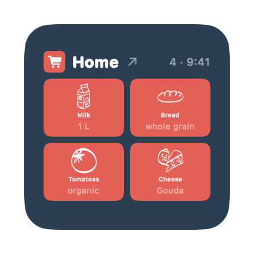
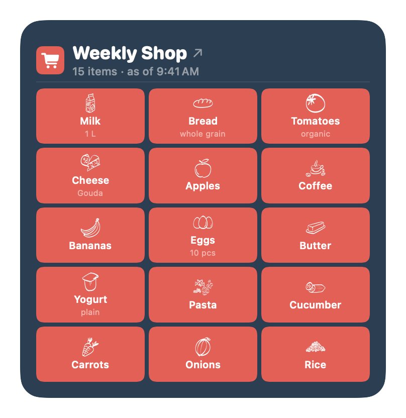
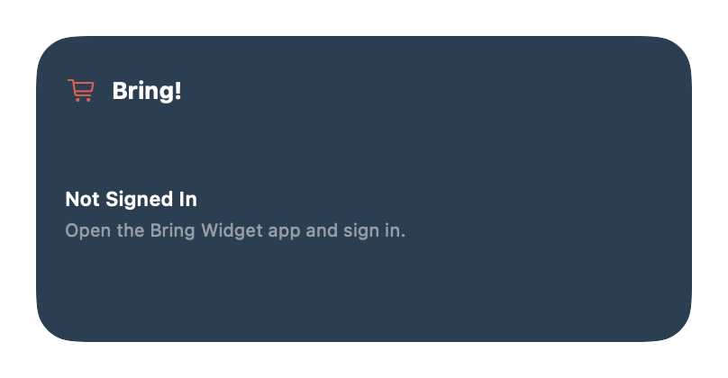

# Guide: Setting up Bring Widget on your Mac

This guide walks you through building and installing Bring Widget yourself
and putting it on your desktop. No programming knowledge required — just a
little patience the first time (about 30 minutes, most of it waiting for
Xcode to download).


> **Unofficial.** This project is not affiliated with Bring! or its
> operator. The app uses the same endpoints as the Bring! web app and keeps
> your credentials on your Mac only.

## Contents

1. [What you need](#1-what-you-need)
2. [Install Xcode](#2-install-xcode)
3. [Developer certificate and Team ID](#3-developer-certificate-and-team-id)
4. [Build and install the app](#4-build-and-install-the-app)
5. [Sign in and choose a list](#5-sign-in-and-choose-a-list)
6. [Put the widget on your desktop](#6-put-the-widget-on-your-desktop)
7. [Start automatically (optional)](#7-start-automatically-optional)
8. [Using the widget](#8-using-the-widget)
9. [Troubleshooting](#9-troubleshooting)
10. [Updating and uninstalling](#10-updating-and-uninstalling)

## 1. What you need

- A Mac running **macOS 14 (Sonoma) or later**
- A **free Apple Account** (your regular Apple ID is enough — no paid
  developer membership needed)
- A **Bring! account** (email + password, as used on
  [web.getbring.com](https://web.getbring.com))
- About **30 GB of free disk space** for Xcode
- [Homebrew](https://brew.sh) for one small helper tool

## 2. Install Xcode

1. Install **Xcode** from the Mac App Store. Pick the version that matches
   your macOS (macOS 27 → Xcode 27).
2. Open Terminal (`⌘ + Space` → "Terminal") and activate Xcode (asks for
   your Mac password):

   ```sh
   sudo xcode-select -s /Applications/Xcode.app/Contents/Developer
   sudo xcodebuild -license accept
   ```

3. Install the helper tool `xcodegen`:

   ```sh
   brew install xcodegen
   ```

## 3. Developer certificate and Team ID

macOS only runs the app and the widget if they are signed. For that you
create a free certificate once.

1. Open **Xcode** → menu **Xcode → Settings… → Accounts**.
2. Click **+** at the bottom left → **Apple Account** → sign in with your
   Apple ID.
3. Select your account → **Manage Certificates…** → **+** →
   **Apple Development**. Close the window.
4. Show your **Team ID** in Terminal. It is the 10-character value after
   `OU=`:

   ```sh
   security find-certificate -c "Apple Development" -p | openssl x509 -noout -subject
   ```

   Example output: `subject= /UID=…/CN=Apple Development: you@example.com (XXXXXXXXXX)/OU=ABCDE12345/O=…`
   (depending on the OpenSSL version the fields are separated by `/` or `,`)
   → your Team ID is `ABCDE12345`.

## 4. Build and install the app

1. Download the project (Terminal):

   ```sh
   git clone https://github.com/AnyUser-Ctrl/bring-macos-widget.git
   cd bring-macos-widget
   ```

2. Enter your Team ID. The file `Config/Team.xcconfig` is never committed —
   it stays on your Mac:

   ```sh
   cp Config/Team.xcconfig.example Config/Team.xcconfig
   open -e Config/Team.xcconfig
   ```

   In the editor, replace `ABCDE12345` with your Team ID from step 3 and
   save.

3. Build, install to `/Applications` and launch — all in one command:

   ```sh
   ./scripts/install.sh
   ```

   When it finishes, the app window opens.

> **Tip:** If you build in Xcode yourself, keep the build output out of
> iCloud Drive: iCloud adds file attributes that break code signing.
> `scripts/install.sh` therefore always builds in a temporary folder.

## 5. Sign in and choose a list

On first launch the sign-in window appears. Sign in with your Bring!
account.


Then pick the list the widget should show. The preview shows its contents
right away.


You can close the window afterwards. The app keeps running in the
background without a Dock icon. If you need it again (other list, sign in
again), open it via Spotlight (`⌘ + Space` → "BringWidget"). If the app wasn't running yet, the first launch stays invisible — press Enter in Spotlight again (or run `open -a BringWidget` a second time) and the window appears.

The app follows your Mac's language: English, or German on a Mac set to
German.

## 6. Put the widget on your desktop

1. Right-click an empty spot on your desktop → **"Edit Widgets…"**.
2. Type **"Bring"** into the search field at the top.
3. Choose **BringWidget** in the list; the widget is called
   **"Bring! Shopping List"**. Don't confuse it with the widgets of the
   official Bring! iPhone app, which macOS marks as iPhone widgets.
4. Pick a size, drag the widget onto your desktop, then click **"Done"**.

| Small | Medium |
| --- | --- |
|  |  |

| Large |
| --- |
|  |

When the list is empty, the widget shows a checkmark:


## 7. Start automatically (optional)

So the widget has fresh data right after a restart:

**System Settings → General → Login Items** (macOS 15 and later: **Login Items & Extensions**) → **"Open at Login" → +** → select
`/Applications/BringWidget.app`.

The app then starts invisibly every time you log in.

## 8. Using the widget

- **Click the list name** (top, with ↗): opens the list on
  web.getbring.com, where you add or check off items.
- **Click the items:** reloads the list immediately.
- On its own, the widget refreshes about every 20 minutes — macOS doesn't
  allow more.
- Item names appear in the article language set for the list in Bring!,
  just like in the Bring! app (if the list has none, your Mac's language
  is used). Items you typed yourself appear as typed.

## 9. Troubleshooting

**The widget says "Not Signed In".**



Open the app via Spotlight and sign in. If the app wasn't running yet, the first launch stays invisible — press Enter in Spotlight again (or run `open -a BringWidget` a second time) and the window appears. If that doesn't help,
remove the widget from the desktop and add it again.

**"Bring Widget" doesn't show up in the widget gallery.**
The app must be in `/Applications` and must have been launched once. Then
run in Terminal:

```sh
killall chronod
```

and open the widget gallery again.

**The app no longer starts, or the widget disappears after a while.**
The Apple Development certificate is valid for one year. Check its
expiry date:

```sh
security find-certificate -a -c "Apple Development" -p | awk '/BEGIN CERT/{c=""} {c=c $0 "\n"} /END CERT/{cmd="openssl x509 -noout -subject -enddate"; printf "%s", c | cmd; close(cmd)}'
```

If it has expired, create a new one in Xcode (step 3, point 3) and run
`./scripts/install.sh` again. Your sign-in and list are kept.

**All widgets have disappeared.**
With Stage Manager turned on, macOS hides desktop widgets. See
**System Settings → Desktop & Dock**.

## 10. Updating and uninstalling

**Update:**

```sh
cd bring-macos-widget
git pull
./scripts/install.sh
```

**Uninstall:**

1. Remove the widget from the desktop (right-click the widget →
   "Remove Widget").
2. If set up: remove the entry from Login Items.
3. Move `/Applications/BringWidget.app` to the Trash.
4. Delete the stored data — email, password and tokens live here (replace
   `<TEAM-ID>` with your Team ID):

   ```sh
   rm -rf ~/Library/Group\ Containers/<TEAM-ID>.com.AnyUser-Ctrl.BringWidget
   ```

## A note on privacy

Your Bring! email and password are stored in plain text in the App Group
container on your Mac (see above), so the app and the widget can sign in
again by themselves when tokens expire. Other sandboxed apps can't read
it; apps with Full Disk Access can. If that's too much risk for you, don't
use the widget on shared Macs.
